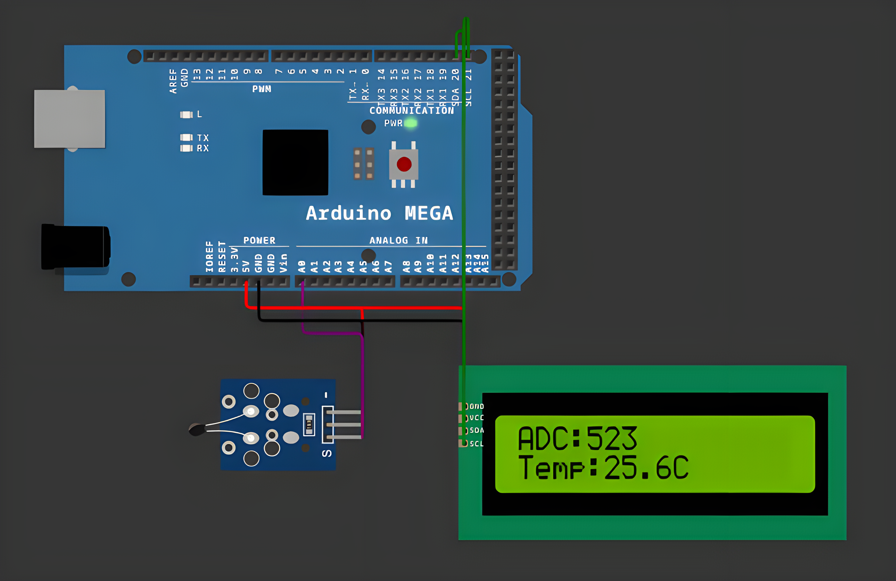

# NTC Temperature Acquisition System

<table align="center">
  <tr>
    <td align="center">
      
    </td>
  </tr>
</table>

## Overview

NTC Temperature Acquisition System is an embedded application for Arduino Mega that reads an
analog signal from an NTC thermistor, converts it into a physical value (°C) and reports it
periodically on a 16x2 I²C LCD and over the Serial terminal. The project is built around a modular
architecture that separates sensor acquisition from display logic.

## Features

- **Periodic Acquisition**: Reads the NTC sensor on pin `A0` every 200 ms using non-blocking
  timing based on `millis()`.
- **Signal Conversion**: Converts the raw ADC value (0..1023) to voltage (`V = RAW * Vref / 1023`)
  and then to a temperature in °C.
- **Periodic Reporting**: Every 500 ms the latest ADC value and temperature are shown on the LCD
  and printed on the Serial terminal.
- **LCD Output**: Line 1 shows the raw ADC value, line 2 shows the temperature with one decimal.
- **Serial Output**: Prints a structured report line, e.g. `ADC: 512 | Temp: 25.0 C`.
- **Clean Architecture**: Sensor and display drivers are implemented as independent classes
  (`NTCSensor`, `LCDDisplay`) for readability, testing and reuse.

## Technologies

- **Platform**: Arduino Mega 2560
- **Language**: C++ (Arduino Framework)
- **Libraries**: LiquidCrystal_I2C
- **Build System**: PlatformIO
- **Simulation**: Wokwi
- **Development Tools**: Visual Studio Code + PlatformIO IDE
- **Version Control**: Git, GitHub

## Project Structure

```
src/
├── ntcsensor/
│   ├── NTCSensor.cpp
│   └── NTCSensor.h
├── lcddisplay/
│   ├── LCDDisplay.cpp
│   └── LCDDisplay.h
└── main.cpp
diagram.json
wokwi.toml
platformio.ini
```

## Pin Mapping

| Component | Pin | Action |
|---|---|---|
| NTC Thermistor (OUT) | A0 | Analog temperature signal input |
| NTC Thermistor (VCC / GND) | 5V / GND | Power supply |
| LCD I²C (SDA) | 20 | I²C data line |
| LCD I²C (SCL) | 21 | I²C clock line |
| LCD I²C (VCC / GND) | 5V / GND | Power supply |

> The LCD uses I²C address `0x27` (some modules use `0x3F`; check with an I²C scanner).
> If a bare thermistor is used, add a 10 kΩ fixed resistor to form a voltage divider:
> `5V → 10 kΩ → OUT (A0) → NTC → GND`.

## Configuration

| Parameter | Value | Description |
|---|---|---|
| `ACQ_PERIOD` | 200 ms | Sensor acquisition period |
| `REPORT_PERIOD` | 500 ms | LCD / Serial reporting period |
| `LCD_ADDR` | `0x27` | I²C address of the LCD |
| Serial baud rate | 9600 | Serial monitor speed |

## Resources

- [Wokwi Documentation](https://docs.wokwi.com/)
- [Arduino Analog Input Reference](https://docs.arduino.cc)
- [PlatformIO Documentation](https://docs.platformio.org)
- [LiquidCrystal_I2C Library](https://github.com/johnrickman/LiquidCrystal_I2C)

## Installation

To build and run the application, follow these steps:

1. **Clone this repository:**
```bash
git clone https://github.com/Constantin-Stamate/sensor-signal-acquisition
```

2. **Navigate to the project directory:**
```bash
cd sensor-signal-acquisition
```

3. **Open the project in VS Code with the PlatformIO extension installed**

4. **Build and upload to the board (or run the Wokwi simulation):**
```bash
pio run --target upload
```

5. **Monitor the output:**
```bash
pio device monitor -b 9600
```

```
Heat or cool the NTC sensor -> the ADC value and temperature change on the LCD
                               and in the Serial terminal every 500 ms
```

## Contributors

**NTC Temperature Acquisition System** was developed as part of the Internet of Things laboratory works.

- GitHub: [Constantin-Stamate](https://github.com/Constantin-Stamate)
- Email: constantinstamate.r@gmail.com